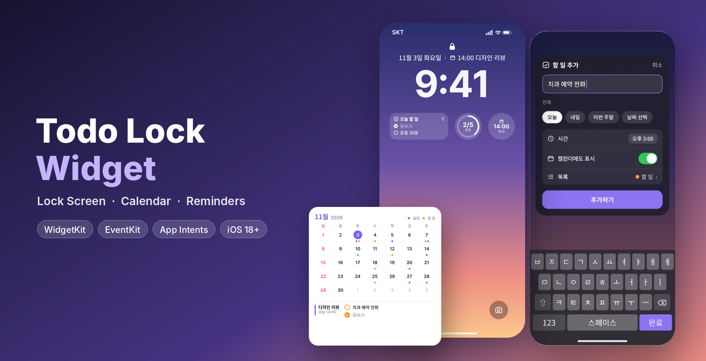
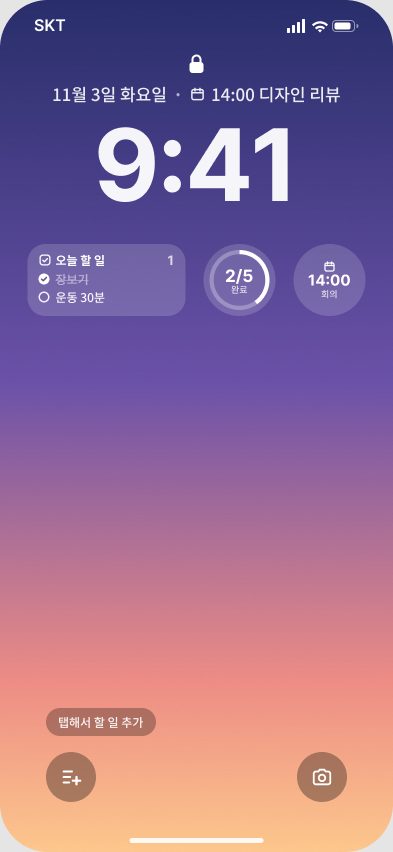
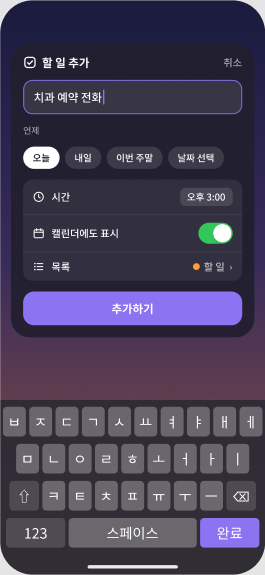
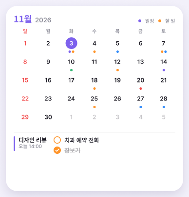
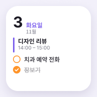
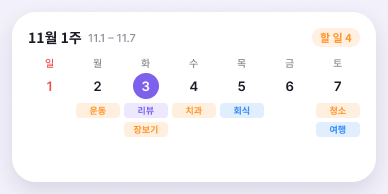
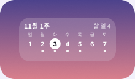
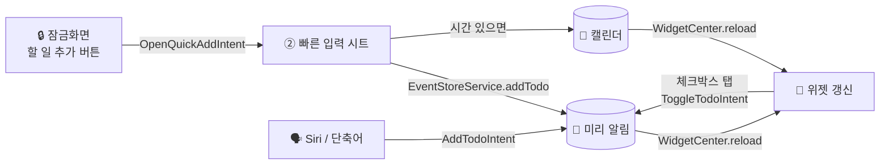
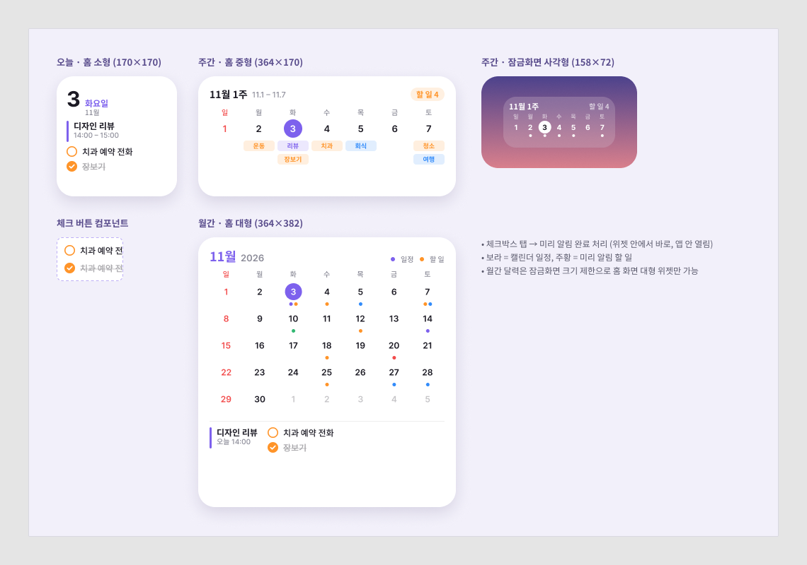
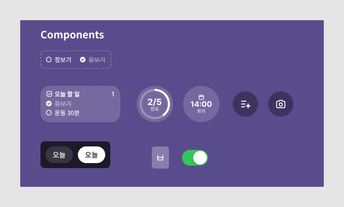

<div align="center">



# Todo Lock Widget

**잠금화면에서 한 번 탭 → 할 일 입력 → 미리 알림 + 캘린더에 자동 표시**<br/>
아이폰 기본 앱(미리 알림 · 캘린더) 가장 빠른 할 일 위젯

<br/>


[**🎨 Figma 디자인 보기**](https://www.figma.com/design/HdceIoyzN6fgrN3c40I4yz) ·
[⚡️ 코딩 없이 쓰기](docs/SHORTCUT_SETUP.md) ·
[🧩 디자인 스펙](docs/DESIGN.md) ·
[🗺 로드맵](#-로드맵)

</div>

---

## ✨ 한눈에 보기

<table>
<tr>
<td align="center" width="33%"><br/><b>① 잠금화면</b><br/><sub>다음 일정 · 오늘 할 일 · 진행률</sub></td>
<td align="center" width="33%"><br/><b>② 빠른 입력</b><br/><sub>버튼 한 번 → 입력 → 날짜 → 끝</sub></td>
<td align="center" width="33%"><br/><b>③ 월간 위젯</b><br/><sub>한 달 일정 + 할 일 점 표시</sub></td>
</tr>
</table>

## 🚀 주요 기능

| | 기능 | 설명 |
|:-:|---|---|
| 🔒 | **잠금화면 위젯** | 오늘 할 일 · 진행률 링 · 다음 일정 · 주간 스트립 |
| ➕ | **원탭 빠른 입력** | 잠금화면 하단 컨트롤(손전등 자리) → 바로 입력 시트 |
| ✅ | **위젯에서 바로 체크** | 앱을 열지 않고 위젯 체크박스로 완료 처리 (인터랙티브 위젯) |
| 📅 | **캘린더 자동 연동** | 할 일은 *미리 알림*, 시간 있는 할 일은 *캘린더*에도 동시 저장 |
| 🗓 | **오늘 / 주간 / 월간** | 홈 화면 소형 · 중형 · 대형 위젯 3종 |
| 🗣 | **Siri · 단축어 · 액션 버튼** | "할일락에 할 일 추가" 한마디로 등록 |
| 🍎 | **기본 앱 그대로** | 데이터는 전부 iCloud 미리 알림 · 캘린더 — 별도 서버/계정 없음 |

## 🧩 위젯 갤러리

<table>
<tr>
<th>오늘 · 소형</th><th>주간 · 중형</th><th>주간 · 잠금화면</th>
</tr>
<tr>
<td></td>
<td></td>
<td></td>
</tr>
</table>

| 위치 | 위젯 | 크기 | 내용 |
|---|---|---|---|
| 잠금화면 | `accessoryRectangular` | 158×72 | 오늘 할 일 2개 + 남은 개수 / 주간 스트립 |
| 잠금화면 | `accessoryCircular` | 72×72 | 진행률 링 `2/5` · 다음 일정 `14:00` |
| 잠금화면 | `accessoryInline` | 시계 위 한 줄 | 📅 14:00 디자인 리뷰 |
| 잠금화면 | `ControlWidget` | 하단 버튼 | ➕ 할 일 추가 |
| 홈 화면 | `systemSmall` | 170×170 | 오늘 날짜 · 첫 일정 · 할 일 |
| 홈 화면 | `systemMedium` | 364×170 | 이번 주 7일 + 일정/할 일 칩 |
| 홈 화면 | `systemLarge` | 364×382 | 월간 달력 + 오늘 아젠다 |

> 🟣 보라 = 캘린더 일정 🟠 주황 = 미리 알림 할 일

## 🔄 동작 흐름



## 🏗 구조

```
todo-lock-widget
├── project.yml                 # XcodeGen 설정 (iOS 18+)
├── TodoLock/                   # 📱 앱
│   ├── TodoLockApp.swift       #   진입점 + Siri 단축어 등록
│   ├── ContentView.swift       #   오늘 일정 · 할 일 목록 · 권한
│   └── QuickAddView.swift      #   ② 빠른 입력 화면
├── TodoLockWidget/             # 🧩 위젯 익스텐션
│   ├── TodoLockWidgetBundle.swift  # 위젯 5종 + 잠금화면 컨트롤
│   ├── Provider.swift          #   타임라인 (다음 일정 시각에 맞춰 갱신)
│   ├── Lock/                   #   잠금화면 위젯
│   ├── Home/                   #   홈 화면 소형 · 중형 · 대형
│   └── Components/             #   체크 버튼 행 · 공통 헬퍼
├── Shared/                     # 앱 ↔ 위젯 공용
│   ├── EventStoreService.swift #   EventKit (미리 알림 · 캘린더) 읽기/쓰기
│   ├── Intents/TodoIntents.swift # Toggle · Add · OpenQuickAdd 인텐트
│   ├── Models.swift  Theme.swift  AppState.swift
└── docs/                       # 디자인 이미지 · 스펙 · 단축어 가이드
```

## 🛠 시작하기

> Mac + Xcode 16 이상이 필요해요.

```bash
brew install xcodegen
```

```bash
git clone https://github.com/sh0204/todo-lock-widget.git && cd todo-lock-widget
```

```bash
xcodegen generate && open TodoLock.xcodeproj
```

1. `project.yml`의 `DEVELOPMENT_TEAM`에 본인 Apple 팀 ID 입력 (또는 Xcode › Signing에서 선택)
2. 아이폰 연결 → ▶︎ 실행 → **미리 알림 · 캘린더 권한 허용**
3. 잠금화면 길게 누르기 → **사용자화 → 잠금 화면**
   - 위젯 칸: `오늘 할 일` · `할 일 진행률` · `다음 일정`
   - 하단 버튼: 손전등 ➖ → ➕ → **할 일 추가**
4. 캘린더 앱 → 캘린더 목록 → **미리 알림 표시** 켜기

> 💡 **코딩 없이** 기본 단축어 앱만으로 쓰고 싶다면 → [SHORTCUT_SETUP.md](docs/SHORTCUT_SETUP.md)

## 🎨 디자인



- **Figma**: <https://www.figma.com/design/HdceIoyzN6fgrN3c40I4yz>
- 컴포넌트: `Widget/Todo Item` (할 일 ↔ 완료 variant), `Calendar/Todo Row`, `Chip`, `Keyboard/Key`, `Switch`
- 색상 · 타이포 · 크기 스펙 → [docs/DESIGN.md](docs/DESIGN.md)



## 🗺 로드맵

- [x] UI 디자인 (잠금화면 · 빠른 입력 · 캘린더 위젯 3종) — Figma
- [x] 프로젝트 뼈대 (앱 + 위젯 익스텐션 + 공용 모듈)
- [x] EventKit 연동 — 미리 알림/캘린더 읽기 · 쓰기 · 완료 토글
- [x] 인터랙티브 체크 버튼 (`Button(intent:)`)
- [x] 잠금화면 컨트롤 (`ControlWidget`) → 빠른 입력
- [ ] 실기기 빌드 & 위젯 레이아웃 미세 조정
- [ ] 위젯 설정: 표시할 미리 알림 목록 / 캘린더 선택 (`AppIntentConfiguration`)
- [ ] 자연어 입력 — "내일 3시 치과" → 날짜 자동 인식
- [ ] 다크 모드 · 틴트 모드(iOS 18) 대응
- [ ] 반복 할 일 · 하위 작업
- [ ] Live Activity — 마감 임박 할 일 카운트다운

## ⚠️ 알아두기

- 잠금화면 위젯은 **안에서 직접 글자 입력이 불가**해요 (애플 제한). 그래서 하단 컨트롤 → 입력 시트 방식을 써요.
- 월간 달력은 잠금화면 크기(최대 158×72) 제한으로 **홈 화면 대형 위젯**에서만 제공해요.
- 위젯 갱신 주기는 iOS가 조절해요. 체크/추가 시에는 즉시 `reloadAllTimelines()`로 갱신해요.

---

<div align="center">

Made with 💜 by [**@sh0204**](https://github.com/sh0204) · MIT License

</div>
