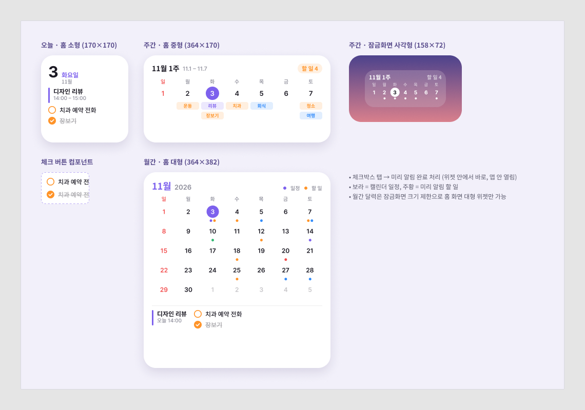
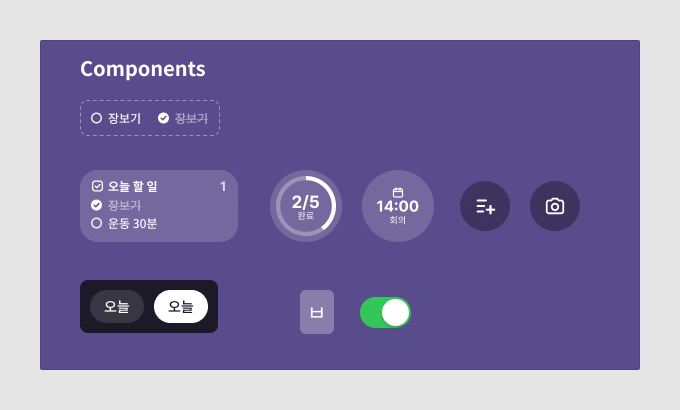
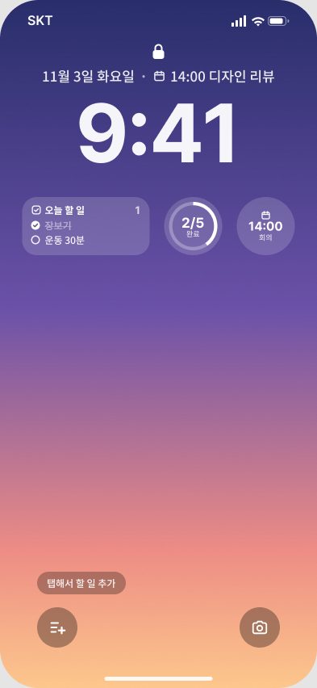
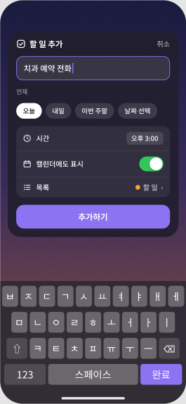

# 🎨 디자인 스펙

> Figma: <https://www.figma.com/design/HdceIoyzN6fgrN3c40I4yz>

## 색상

| 토큰 | HEX | 용도 |
|---|---|---|
| `event` | `#7D61ED` | 캘린더 일정, 오늘 날짜 원, 주요 버튼 |
| `todo` | `#FF9429` | 미리 알림 할 일, 체크박스 |
| `sunday` | `#F24D4D` | 일요일 |
| `blue` | `#338CFA` | 보조 일정 (회식/여행 등) |
| `text` | `#1C1A24` | 본문 |
| `secondary` | `#8C8C99` | 보조 텍스트 |
| 잠금화면 위젯 배경 | `#FFFFFF` 16% + 배경 블러 20 | 잠금화면 위젯 |

## 타이포그래피

| 용도 | 폰트 | 크기 / 굵기 |
|---|---|---|
| 잠금화면 시계 | SF Pro Rounded | 100 / Bold |
| 위젯 제목 | SF Pro (한글: Apple SD Gothic Neo) | 12–14 / Bold |
| 할 일 텍스트 | 〃 | 12 / Medium |
| 보조 (시간·요일) | 〃 | 9–11 / Medium |
| 대형 날짜 숫자 | SF Pro | 30 / Bold |

> Figma 시안은 한글 렌더링을 위해 Noto Sans KR + Inter를 사용했어요. 실제 앱은 시스템 폰트를 사용해요.

## 크기

| 위젯 | 크기(pt) | 모서리 |
|---|---|---|
| 잠금화면 사각형 | 158 × 72 | 18 |
| 잠금화면 원형 | 72 × 72 | 원 |
| 홈 소형 | 170 × 170 | 24 |
| 홈 중형 | 364 × 170 | 24 |
| 홈 대형 | 364 × 382 | 24 |
| 잠금화면 컨트롤 | 50 × 50 | 원 |

## 컴포넌트

| 이름 | Variant / 속성 | 설명 |
|---|---|---|
| `Widget/Todo Item` | `State` = 할 일 · 완료, `Label` | 잠금화면용 흰색 체크 행 |
| `Calendar/Todo Row` | `State` = 할 일 · 완료, `Label` | 홈 위젯용 주황 체크 행 |
| `Chip` | `State` = 기본 · 선택, `Label` | 빠른 입력 날짜 칩 |
| `Control/할 일 추가` | — | 잠금화면 하단 버튼 |
| `Keyboard/Key`, `Switch/On` | — | 빠른 입력 화면 목업 |

## 화면

| ① 잠금화면 | ② 빠른 입력 |
|---|---|
|  |  |
